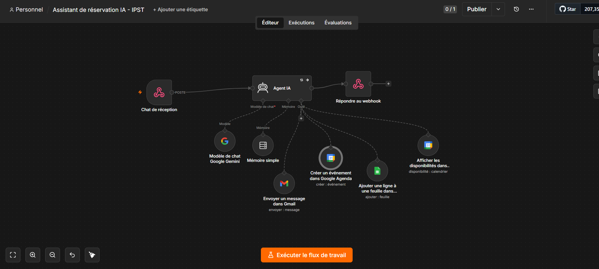

# AI Booking Assistant - IPST

Chatbot IA pour l'IPST (International Private School of Technology, Fès). Il répond aux questions sur les formations, prend les rendez-vous dans Google Calendar, envoie la confirmation par Gmail et enregistre les visiteurs intéressés dans Google Sheets.

Construit avec n8n et Google Gemini.

## Démo

[](https://www.youtube.com/watch?v=7pun3QGJpXw)

La démo a été réalisée en injectant le widget dans la page du site via les outils développeur du navigateur (F12), à titre de démonstration. Ce n'est pas une intégration en production sur le site officiel.

## Workflow



## Fonctionnement

1. Le visiteur écrit dans le widget de chat.
2. Le widget envoie le message à un webhook n8n (`chat-assistant`).
3. L'agent IA (Gemini) répond avec la base de connaissances de l'école et choisit ses outils :
   - **Google Calendar** : vérifie les disponibilités et crée le rendez-vous
   - **Gmail** : envoie la confirmation au visiteur
   - **Google Sheets** : enregistre le lead (prénom, email, téléphone, formation, date)
4. La réponse revient au widget. Une mémoire de 10 messages garde le contexte de la conversation.

## Prérequis

- Une instance n8n (cloud ou self-hosted)
- Une clé API Gemini (Google AI Studio)
- Un compte Google (Gmail, Calendar, Sheets)

## Installation

1. Importe `workflow.json` dans n8n (Workflows > Import from file).
2. Crée les credentials et associe-les aux nœuds :
   - **Google Gemini (PaLM) API** : nœud `Google Gemini Chat Model`
   - **Gmail OAuth2** : nœud `Send a message in Gmail`
   - **Google Sheets OAuth2** : nœud `Append row in sheet in Google Sheets`
   - **Google Calendar OAuth2** : nœuds `Get availability...` et `Create an event...`
3. Crée une feuille Google Sheets avec un onglet **Leads** et ces colonnes : `Prénom`, `Email`, `Téléphone`, `Formation`, `Date`. Sélectionne-la dans le nœud Google Sheets.
4. Dans les deux nœuds Google Calendar, sélectionne ton calendrier.
5. Dans le nœud `AI Agent`, adapte le message système (nom de l'école, contact, formations, tarifs).
6. Active le workflow et récupère l'URL de production du webhook :
   `https://TON-DOMAINE-N8N/webhook/chat-assistant`

## Widget de chat

Le fichier `widget/chat-widget.js` est un widget minimal sans dépendance.

1. Ouvre le fichier et remplace `WEBHOOK_URL` par l'URL de production de ton webhook.
2. Pour tester : colle le code dans la console du navigateur (F12) sur n'importe quelle page.
3. Pour l'intégrer à un site : ajoute-le avec une balise `<script>` avant `</body>`.

Format d'échange avec le webhook :

```
POST /webhook/chat-assistant
{ "chatInput": "Bonjour", "sessionId": "abc123" }

Réponse : { "output": "Bonjour ! Comment puis-je vous aider ?" }
```

## Personnalisation

Tout le comportement de l'assistant (ton, formations, règles, longueur des réponses) se règle dans le message système du nœud `AI Agent`. La date du jour est injectée automatiquement pour éviter les rendez-vous dans le passé.

## Sécurité

- Aucune clé ni credential n'est inclus dans ce dépôt.
- Le webhook est public : toute personne qui connaît l'URL peut l'appeler et consommer ton quota Gemini. Pour la production, limite les origines autorisées (option CORS du nœud Webhook) et ajoute une protection (clé secrète, limitation de débit).

## Licence

MIT
